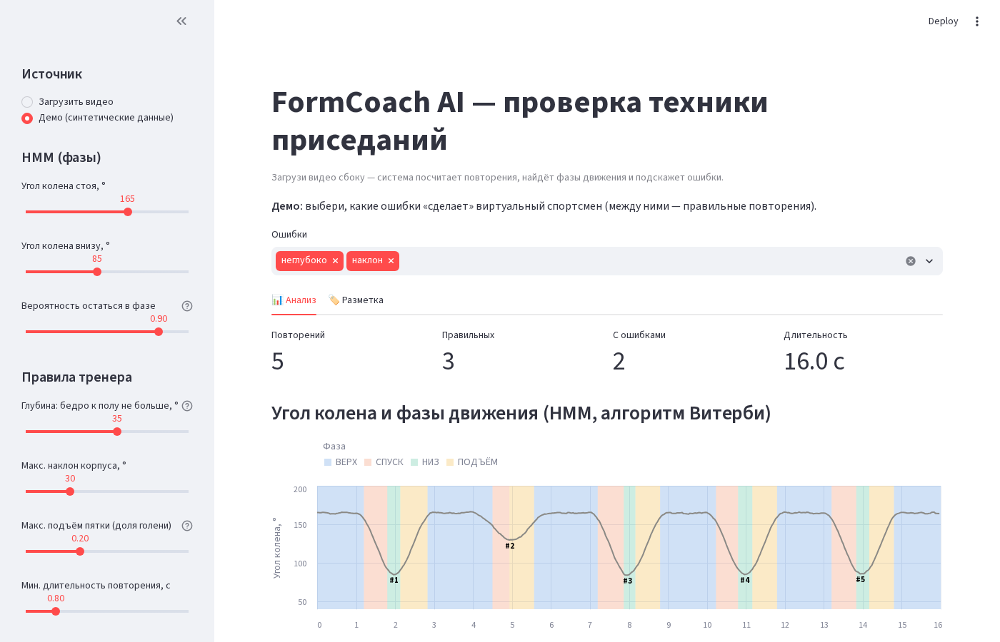
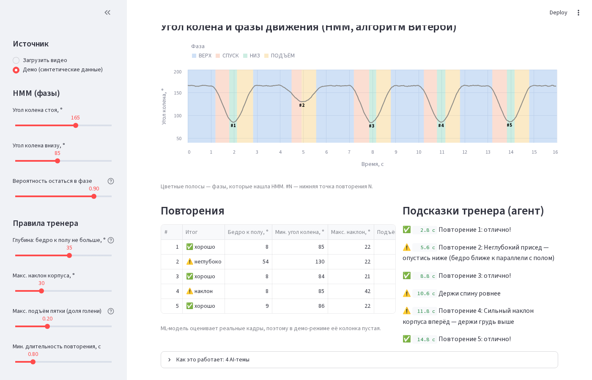
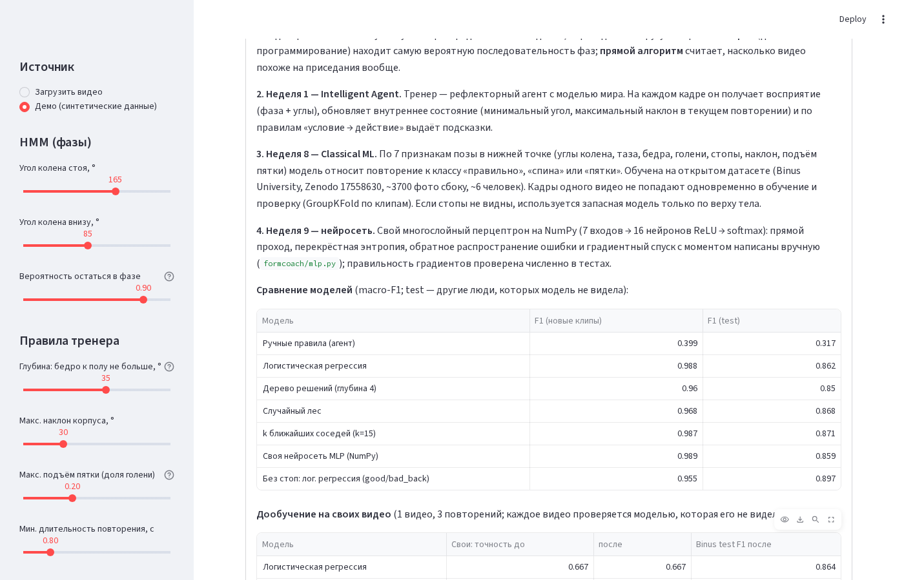

# FormCoach AI — проверка техники приседаний по видео

Загружаешь видео приседаний, снятое сбоку. Система считает повторения, находит фазы движения
(вниз / низ / вверх) и для каждого повторения говорит, что не так: неглубоко, наклон корпуса,
отрыв пяток, слишком быстро.

Финальный проект курса **AI Fundamentals** (QAIRU AI Application Development Challenge 2026).

Полный технический отчёт: [docs/TECHNICAL_REPORT.md](docs/TECHNICAL_REPORT.md) (есть и [.docx](docs/TECHNICAL_REPORT.docx)).

## Три (четыре) AI-темы курса — реализованы своим кодом

MediaPipe Pose используется **только как датчик**: он превращает кадр в 33 точки тела.
Анализ техники целиком написан в этом проекте.

| Неделя | Тема | Где в коде | Что делает |
|---|---|---|---|
| 1 | Интеллектуальный агент | `formcoach/agent.py` | Тренер: восприятие → внутреннее состояние → правила «условие → действие» → подсказки |
| 7 | Скрытая марковская модель (HMM) | `formcoach/hmm.py` | Фазы приседа и счёт повторений: свой алгоритм Витерби и прямой алгоритм |
| 8 | Классическое ML | `formcoach/classifier.py`, `formcoach/retrain.py` | Классификатор «правильно / спина / пятки», сравнение 5 моделей, честная проверка |
| 9 | Нейросети | `formcoach/mlp.py` | Свой перцептрон на NumPy: прямой проход, backprop, градиентный спуск |

### Неделя 1 — Агент-тренер
- **Цель:** давать подсказки по технике по ходу видео, как живой тренер.
- **Тип:** рефлекторный агент с моделью мира (Russell & Norvig).
  **PEAS:** P — верно посчитанные повторения и точные подсказки; E — человек перед камерой;
  A — сообщения на экране; S — камера + MediaPipe + HMM.
- **Вход:** на каждом кадре фаза от HMM и углы тела (колено, бедро, наклон корпуса, подъём пятки).
  Всё видео сразу агент не видит.
- **Шаги:** запомнить в состоянии номер повторения, минимальный угол, максимальный наклон →
  проверить правила (`наклон > 30°` → «держи спину», `бедро не дошло до 35°` → «опустись ниже» и т.д.) →
  выдать подсказку уровня ok / warn / danger.
- **Выход:** список подсказок с номером кадра и отчёт по каждому повторению.
- **Параметры в интерфейсе:** все пороги правил (глубина, наклон, пятки, длительность).
- **Ограничения:** пороги заданы вручную. Пятки не оцениваются, если стопы плохо видно.
  Порог пяток 0.2 пока не подобран по своим видео.

### Неделя 7 — HMM: фазы и повторения
- **Цель:** надёжно разбить видео на фазы и посчитать повторения, не сбиваясь от шума.
- **Скрытые состояния:** ВЕРХ → СПУСК → НИЗ → ПОДЪЁМ → ВЕРХ. **Наблюдения:** угол колена и его скорость.
- **Шаги:** гауссовы вероятности наблюдений → **Витерби** (динамическое программирование) находит самую
  вероятную последовательность фаз → **прямой алгоритм** даёт log P(видео | модель): насколько видео
  вообще похоже на приседания. Всё считается в логарифмах, чтобы вероятности не обнулились.
- **Почему не порог «угол < 100°»:** порог дёргается от шума и не отличает спуск от подъёма, ведь угол
  в них одинаковый. HMM учитывает скорость и строгий порядок фаз.
- **Параметры в интерфейсе:** угол колена стоя и внизу, вероятность остаться в фазе.
- **Ограничения:** параметры заданы вручную (без обучения Баума — Велша). Модель рассчитана на приседания сбоку.

### Неделя 8 — Классификатор техники
- **Цель:** вторая независимая оценка повторения, в дополнение к правилам агента.
- **Вход:** 7 признаков позы в нижней точке: углы колена, таза, бедра к полу, голени, голеностопа,
  наклон корпуса, подъём пятки. Это углы и отношения длин, поэтому они не зависят от расстояния до камеры.
- **Данные:** открытый датасет Binus University ([Zenodo 17558630](https://zenodo.org/records/17558630)),
  3741 фото сбоку, 3 класса.
- **Главная ловушка:** соседние фото в датасете — почти одинаковые кадры одного видео. Если делить их
  случайно, точность будет завышена. Поэтому фото группируются в клипы, и проверка идёт только на
  клипах, которых модель не видела (**GroupKFold**). Отдельный test — другие люди.
- **Выход:** вероятности классов «правильно / спина / пятки» для каждого повторения
  (усредняются по кадрам нижней точки ±3).
- **Если стопы не видны:** запасная модель только по верху тела (правильно / спина).
- **Дообучение на своих видео** (`retrain.py`): свои размеченные повторения добавляются к Binus.
  Оценка — **leave-one-video-out**: каждое своё видео проверяет модель, которая его не видела.
- **Ограничения:** в Binus ошибки преувеличенные (наклон ~64°). Мягкие ошибки реального человека
  модель, обученная только на Binus, пропускает. Для этого и нужна своя разметка.

### Неделя 9 — Своя нейросеть (MLP на NumPy)
- **Архитектура:** 7 входов → 16 нейронов ReLU → softmax (3 класса).
- **Шаги:** прямой проход → перекрёстная энтропия + L2 → **обратное распространение ошибки** (формулы
  в начале `mlp.py`) → мини-батчи и градиентный спуск с моментом.
- **Проверка:** градиенты backprop сравниваются с численными. Сеть решает XOR, который без скрытого
  слоя не решается.
- По CV сеть оказалась лучшей из пяти моделей, поэтому приложение использует именно её.
- **Ограничения:** один скрытый слой, гиперпараметры подобраны вручную. На test она не лучше
  логистической регрессии: признаков мало, и задача почти линейная.

## Метрики

HMM и агент на 300 синтетических сессиях с известным ответом (`python scripts/eval_synthetic.py`):

| Что меряем | Результат |
|---|---|
| Точно посчитано число повторений: HMM + агент | **100 %** |
| То же для наивного порога «угол колена < 120°» | 46.3 % |
| Поиск ошибок агентом, F1 (неглубоко / наклон / пятки / быстро) | 1.00 / 1.00 / 1.00 / 0.99 |

Синтетика идеализирована: она проверяет логику. Реальные цифры дадут свои размеченные видео.

Классификатор (macro-F1, `python -m formcoach.classifier`):

| Модель | Accuracy, новые клипы (CV) | F1, новые клипы (CV) | Accuracy, test | F1, test |
|---|---|---|---|---|
| Ручные правила агента | 0.463 | 0.399 | 0.418 | 0.317 |
| Логистическая регрессия | 0.988 | 0.988 | 0.863 | 0.862 |
| Дерево решений (глубина 4) | 0.959 | 0.960 | 0.852 | 0.850 |
| Случайный лес | 0.967 | 0.968 | 0.869 | 0.868 |
| k ближайших соседей (k=15) | 0.986 | 0.987 | 0.873 | 0.871 |
| **Своя нейросеть MLP (NumPy)** | **0.989** | **0.989** | 0.861 | 0.859 |
| Без стоп (правильно / спина) | 0.955 | 0.955 | 0.898 | 0.897 |

Разница между CV (0.99) и test (0.86) показывает, как модель переносится на новых людей.
Честная цифра — test.

Дообучение на своих видео (`python -m formcoach.retrain`): пока размечено одно видео,
поэтому «до» и «после» совпадают. Результаты появятся после разметки 4 видео.

Скорость: анализ HMM + агент занимает доли секунды. Дольше всего работает распознавание позы
MediaPipe на CPU, порядка реального времени видео. Обучение всех моделей заняло ~18 с.

## Архитектура

```
видео ──► pose.py (MediaPipe, датчик) ──► 33 точки тела на кадр
                                              │
                                   features.py (углы, скорости)
                                              │
                    ┌─────────────────────────┼──────────────────────────┐
                    ▼                         ▼                          ▼
             hmm.py (нед. 7)          agent.py (нед. 1)          classifier.py / mlp.py
       Витерби: фазы, повторения ─► правила → подсказки       (нед. 8–9) класс повторения
                    └──────────────── pipeline.py ───────────────────────┘
                                              │
                    ┌─────────────────────────┴──────────────────────────┐
                    ▼                                                    ▼
      server.py (FastAPI, JSON API)                               app.py (Streamlit)
      web/ — мобильный сайт (PWA) для телефона       «Анализ» · «Разметка» ──► labels.py ──► retrain.py
```

| Файл | Назначение |
|---|---|
| `server.py` | Сервер мобильного сайта: принимает видео, вызывает `pipeline.py`, отдаёт JSON |
| `web/` | Мобильный интерфейс (HTML/CSS/JS): съёмка видео, результат, настройки; ставится на телефон как приложение (PWA) |
| `app.py` | Интерфейс для разработчика на Streamlit: подробные таблицы и разметка своих видео |
| `formcoach/pose.py` | Видео → точки тела (MediaPipe Pose Landmarker) |
| `formcoach/features.py` | Углы суставов, сглаживание, признаки кадра |
| `formcoach/hmm.py` | Гауссова HMM, Витерби, прямой алгоритм |
| `formcoach/agent.py` | Агент-тренер и его правила |
| `formcoach/classifier.py` | Обучение и сравнение моделей, классификация повторения |
| `formcoach/mlp.py` | Своя нейросеть на NumPy |
| `formcoach/labels.py` | Сохранение своей разметки повторений |
| `formcoach/retrain.py` | Дообучение на своих видео, оценка «до / после» |
| `formcoach/synthetic.py` | Синтетические приседания для тестов и демо-режима |
| `scripts/build_binus_features.py` | Датасет Binus → таблица признаков |
| `scripts/eval_synthetic.py` | Метрики HMM и агента на синтетике |

## Установка и запуск

Нужен **Python 3.12**: MediaPipe не поддерживает Python 3.14. Удобнее всего через [uv](https://docs.astral.sh/uv/):

```bash
git clone https://github.com/reysalomon/formcoach-ai.git
cd formcoach-ai
uv venv --python 3.12 .venv
uv pip install --python .venv -r requirements.txt
```

На Fedora (в том числе в WSL) MediaPipe нужны системные графические библиотеки:

```bash
sudo dnf install libglvnd-egl libglvnd-gles mesa-libEGL
```

(на Ubuntu/Debian: `sudo apt install libegl1 libgles2`)

Запуск мобильного сайта:

```bash
.venv/bin/uvicorn server:app --host 0.0.0.0 --port 8000
```

Откроется http://localhost:8000. Чтобы открыть сайт с телефона в той же Wi-Fi сети, зайди на
`http://<IP компьютера>:8000`. Съёмка и выбор видео работают и так, а установка «как приложение»
требует HTTPS, то есть сайт нужно выложить в интернет (см. ниже).

На телефоне: меню браузера → **«Добавить на главный экран»** (Android: кнопка «Установить» на сайте).
Появится иконка FormCoach, и сайт откроется на весь экран, как приложение.

Интерфейс для разработчика и разметки своих видео (Streamlit):

```bash
.venv/bin/streamlit run app.py
```

Откроется http://localhost:8501. Если ImportError появился после установки библиотек,
полностью перезапусти streamlit (Ctrl+C и запусти снова).

### Выкладка в интернет

В репозитории есть `Dockerfile`. Его можно запустить на любом хостинге с Docker, например бесплатно
на **Hugging Face Spaces**: New Space → SDK **Docker** → загрузить файлы репозитория. Сайт будет
доступен по адресу `https://<имя>-<space>.hf.space`.

Модель позы (`models/pose_landmarker_full.task`), обученный классификатор и таблица признаков
Binus уже лежат в репозитории, поэтому скачивать ничего не нужно.

### Как пользоваться
1. В боковой панели выбери «Загрузить видео» или «Демо (синтетические данные)», если видео нет.
2. Видео: камера **сбоку**, всё тело в кадре, желательно вместе со стопами.
3. Во вкладке **«Анализ»** смотри график фаз, таблицу повторений с ошибками и мнением модели,
   подсказки тренера и объяснение алгоритмов.
4. Пороги агента и параметры HMM меняются ползунками в боковой панели, результат пересчитывается сразу.
5. Во вкладке **«Разметка»** отметь, что было на самом деле в каждом повторении, и нажми «Сохранить».
   Это данные для дообучения.

### Переобучение моделей

```bash
.venv/bin/python -m formcoach.classifier        # обучить и сравнить модели на Binus
.venv/bin/python -m formcoach.retrain           # отчёт «до / после» на своих видео
.venv/bin/python -m formcoach.retrain --save    # сохранить дообученную модель для приложения
```

Пересобрать признаки из фото Binus нужно, только если меняются признаки. Для этого скачай датасет
с Zenodo, распакуй в `data/external/binus/{train,test}/…` и запусти
`.venv/bin/python scripts/build_binus_features.py`.

## Тесты

```bash
.venv/bin/python -m pytest -q
```

Результат: **65 passed** (~7–11 с). Что проверяется:

- `test_core.py` — геометрия углов, сглаживание, HMM: счёт повторений, порядок фаз, неглубокий присед,
  стояние на месте = 0 повторений, Витерби ≤ полной вероятности, неверные параметры отклоняются.
- `test_agent.py` — каждая ошибка находится, подсказка приходит до конца повторения, пороги меняются,
  шум / ходьба / недоделанное повторение не считаются, пятки не судятся без стоп.
- `test_classifier.py` — разбиение на клипы, правила, признаки кадра, запасная модель без стоп,
  пропуски в признаках отклоняются.
- `test_mlp.py` — backprop против численного градиента, XOR, вероятности, воспроизводимость, ошибки ввода.
- `test_retrain.py` — перевод своих меток в классы, окно кадров, дообучение замечает мягкий наклон
  на новом видео.
- `test_labels.py` — сохранение и перезапись разметки, неверная разметка не сохраняется.
- `test_app.py` — приложение запускается, демо-режим находит ошибки, ползунок меняет результат.
- `test_server.py` — API мобильного сайта: демо, настройки меняют результат, неверные настройки и файлы
  отклоняются с понятным сообщением, видео без человека, полный анализ на точках тела из настоящего видео.

## Скриншоты

Демо-режим (синтетический спортсмен с ошибками «неглубоко» и «наклон»):

**Фазы HMM на графике угла колена и итоги анализа**


**Повторения и подсказки агента-тренера**


**Объяснение алгоритмов и сравнение моделей**


## Ограничения проекта
- Только приседания и только вид сбоку.
- Качество зависит от MediaPipe: при плохом свете или обрезанных стопах точки «прыгают».
- Своих размеченных видео пока мало. Пороги агента и дообучение — следующий шаг.
- Это учебный проект, а не медицинский совет. При боли упражнение нужно прекратить.

## Вклад участников
Проект выполнен одним студентом (GitHub: [reysalomon](https://github.com/reysalomon)): постановка
задачи и решения, сбор и разметка своих видео, проверка на реальных данных, защита. Код, тесты и
документация написаны с помощью AI-ассистента Claude Code по указаниям студента. Подробно — в
[AI Usage Declaration](docs/AI_USAGE_DECLARATION.md) и [Team Contribution Statement](docs/TEAM_CONTRIBUTION.md).
