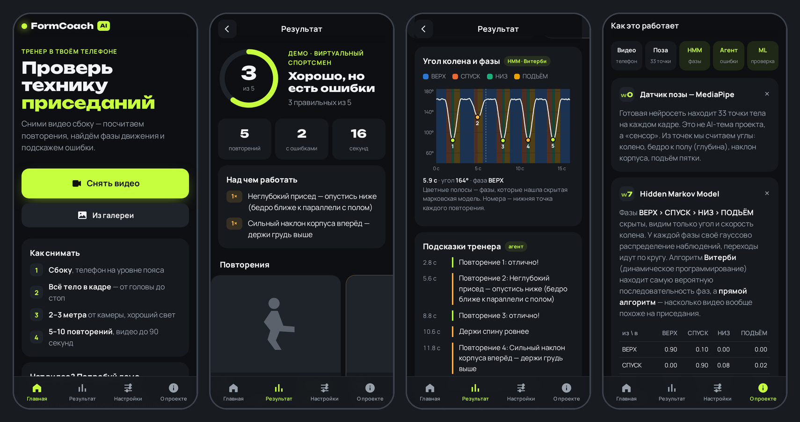

# Аннотация

FormCoach AI — мобильный веб-сайт (PWA), который открывается в браузере телефона и ставится на
главный экран как приложение. По видео приседаний, снятому сбоку, он считает повторения,
находит фазы движения и сообщает об ошибках техники: недостаточная глубина, наклон корпуса,
отрыв пяток, слишком быстрый темп. Детектор позы MediaPipe используется только как датчик
координат суставов. Анализ движения построен на четырёх темах курса и полностью реализован
собственным кодом:

- **агент-тренер** (неделя 1);
- **скрытая марковская модель** со своим алгоритмом Витерби (неделя 7);
- **классификаторы техники** с честной проверкой на новых людях (неделя 8);
- **многослойный перцептрон на NumPy** с ручным обратным распространением ошибки (неделя 9).

На открытом датасете (3741 фото, 3 класса) лучшая модель даёт macro-F1 **0.989** на новых клипах
и **0.86** на людях, которых не было в обучении. Ручные правила на тех же данных дают только 0.32.
На 300 синтетических сессиях HMM верно считает повторения в **100 %** случаев, а наивный порог —
в 46 %. Распознавание позы работает в реальном времени (~30 кадров/с на CPU), сам анализ
занимает ~0.1 с на видео.

# 1. Постановка задачи

**Проблема.** Люди, которые тренируются дома без тренера, часто приседают с ошибками: неглубоко,
с наклоном корпуса или с отрывом пяток. Это снижает пользу упражнения и повышает нагрузку на
спину и колени.

**Цель.** Приложение, которое по обычному видео с телефона:

1. считает повторения;
2. определяет фазы каждого повторения;
3. для каждого повторения называет конкретные ошибки и объясняет, как их исправить;
4. показывает, как алгоритм пришёл к ответу, и позволяет менять его параметры.

**Требование курса.** Методы как минимум трёх разных недель силлабуса должны быть реализованы
своим кодом. Подключение готового AI API не засчитывается. В проекте четыре темы: недели 1, 7, 8, 9.

**Границы.** Только приседания, только вид сбоку, один человек в кадре.

# 2. Данные

| Источник | Что это | Объём | Для чего |
|---|---|---|---|
| Binus University, Zenodo 17558630 | Фото приседаний сбоку, классы good / bad back / bad heel | 3806 фото → 3741 после фильтра, 58 клипов, ~6 человек | Обучение и проверка классификатора |
| Свои видео (телефон) | Реальные приседания автора, размечены в приложении | 1 видео, 4 повторения (сбор продолжается) | Дообучение и проверка на реальном человеке |
| Синтетические сессии (`synthetic.py`) | Признаки, сгенерированные формулой с известным ответом | 300 сессий, 3–8 повторений, шум 1–5° | Тесты и метрики HMM и агента |

**Подготовка Binus** (`scripts/build_binus_features.py`). На каждом фото MediaPipe находит
33 точки тела. Фото, где поза не найдена (36 шт.) или нога видна плохо (29 шт.), отбрасываются.

**Утечка данных.** Соседние фото в Binus — почти одинаковые кадры одного видео. При случайном
делении точность получалась бы завышенной. Поэтому фото объединяются в клипы по резкой смене
картинки (сравнение миниатюр 16×16), и при кросс-валидации клип целиком попадает либо в обучение,
либо в проверку (**GroupKFold**). Официальный test-split Binus содержит других людей. Это главная
честная оценка.

# 3. Архитектура системы

```
видео ──► pose.py (MediaPipe — датчик) ──► 33 точки тела на кадр
                                               │
                                    features.py: углы, скорости, сглаживание
                                               │
                 ┌─────────────────────────────┼──────────────────────────────┐
                 ▼                             ▼                              ▼
          hmm.py (нед. 7)              agent.py (нед. 1)            classifier.py + mlp.py
     Витерби: фазы, повторения ──►  правила → подсказки            (нед. 8–9) класс повторения
                 └────────────────── pipeline.py ─────────────────────────────┘
                                               │
                 ┌─────────────────────────────┴──────────────────────────────┐
                 ▼                                                            ▼
   server.py (FastAPI, JSON API)                                     app.py (Streamlit)
   web/ — мобильный сайт (PWA) для телефона             «Анализ» · «Разметка» ──► labels.py ──► retrain.py
```

Система разделена на две части. **Сервер** (`server.py`) принимает видео с телефона, вызывает
`pipeline.py` и возвращает результат в JSON. **Клиент** (`web/`: HTML, CSS, JavaScript) работает
в браузере телефона: снимает или выбирает видео, отправляет его на сервер и рисует результат.
Вся AI-логика находится только на сервере, в пакете `formcoach/`, поэтому мобильный сайт и
Streamlit-интерфейс используют один и тот же код.

**Признаки** (`features.py`). Все признаки — углы или отношения длин, поэтому они не зависят от
расстояния до камеры и размера кадра. Используются:

- угол колена и его скорость;
- угол в тазобедренном суставе;
- наклон корпуса от вертикали;
- угол бедра к полу — по нему меряется глубина, нужны только таз и колено;
- наклон голени и угол голеностопа;
- подъём пятки в долях длины голени.

Берётся та сторона тела, которую камера видит лучше. Сигналы сглаживаются скользящим средним.
Если стопы видны плохо (уверенность MediaPipe < 0.5), пятки не оцениваются: система говорит
«не знаю», а не выдумывает ответ.

**Технологии:** Python 3.12, NumPy, pandas, scikit-learn (только для классических моделей
недели 8), MediaPipe Pose Landmarker (датчик), OpenCV, FastAPI + uvicorn (сервер),
HTML/CSS/JavaScript без фреймворков (мобильный клиент, PWA), Streamlit + Altair (интерфейс
разработчика), pytest, Docker.

# 4. AI-методы

## 4.1. Неделя 7 — Скрытая марковская модель: фазы и повторения

**Цель.** Разбить видео на фазы движения и посчитать повторения так, чтобы шум датчика не
создавал ложных повторений.

**Почему HMM.** Простой порог («угол колена < 120° — значит, внизу») дёргается от шума. Кроме того,
он не отличает спуск от подъёма: угол в них одинаковый. HMM учитывает и скорость, и то, что фазы
идут строго по кругу.

**Модель** (`formcoach/hmm.py`):

- скрытые состояния — ВЕРХ → СПУСК → НИЗ → ПОДЪЁМ → ВЕРХ;
- наблюдения — угол колена и его скорость (2 признака);
- вероятности наблюдений — гауссовы, с диагональной ковариацией;
- матрица переходов разрешает только переходы по кругу (плюс возврат из СПУСКА в ПОДЪЁМ для
  недоделанного повторения); вероятность остаться в фазе задаётся параметром `stay_prob`.

**Вход:** покадровые признаки и параметры (угол стоя, угол внизу, `stay_prob`) — все меняются в
интерфейсе. **Выход:** фаза каждого кадра и log P(видео | модель).

**Шаги:**

1. Посчитать log-вероятность наблюдения каждого кадра в каждом состоянии.
2. **Алгоритм Витерби** (динамическое программирование): δₜ(j) = maxᵢ[δₜ₋₁(i) + log aᵢⱼ] + log bⱼ(xₜ),
   с запоминанием лучшего предка и обратным проходом. Результат — самая вероятная
   последовательность фаз.
3. **Прямой алгоритм**: αₜ(j) = logsumexp_i[αₜ₋₁(i) + log aᵢⱼ] + log bⱼ(xₜ). Он даёт полную
   вероятность видео — насколько видео вообще похоже на приседания.
4. Все вычисления идут в логарифмах (logsumexp), чтобы произведение сотен вероятностей не
   превратилось в 0.

**Тесты:** верный счёт трёх повторений; фазы идут только в допустимом порядке; неглубокий присед
засчитывается как повторение; стояние на месте даёт 0 повторений; видео с приседаниями вероятнее,
чем стояние; оценка Витерби не превышает полную вероятность (математический инвариант);
некорректные параметры отклоняются.

**Метрики** (300 синтетических сессий, шум 1–5°, `scripts/eval_synthetic.py`):

| Метод счёта | Точно угадано число повторений | Средняя ошибка (повторений на сессию) |
|---|---|---|
| **HMM + агент** | **100 %** | **0.00** |
| Порог «угол < 120°» | 46.3 % | 0.73 |

Порог ошибается по двум причинам: пропускает неглубокие приседания и считает дважды, когда
шум колеблется около порога.

**Ограничения.** Параметры HMM заданы вручную, а не обучены алгоритмом Баума — Велша. Модель
рассчитана только на приседания. Синтетика идеализирована: метрика счёта на реальных видео будет
добавлена после разметки своих видео.

## 4.2. Неделя 1 — Интеллектуальный агент-тренер

**Цель.** Как живой тренер, давать подсказки по ходу видео и подводить итог каждого повторения.

**Тип агента:** рефлекторный агент с моделью мира (model-based reflex agent, Russell & Norvig).

| PEAS | |
|---|---|
| Performance | Верно посчитанные повторения, точные и своевременные подсказки |
| Environment | Человек, выполняющий приседания перед камерой |
| Actuators | Текстовые подсказки уровня ok / warn / danger |
| Sensors | Камера + MediaPipe (точки тела) + HMM (фаза) |

**Вход (восприятие):** на каждом кадре фаза от HMM и текущие углы. Всё видео сразу агент не видит.
**Внутреннее состояние:** номер повторения, кадр начала, минимальный угол колена и бедра,
максимальный наклон и подъём пятки в текущем повторении. **Выход:** список подсказок с кадром и
отчёт по каждому повторению.

**Правила «условие → действие»** (`formcoach/agent.py`, все пороги меняются ползунками):

| Условие | Действие |
|---|---|
| Наклон корпуса > 30° во время повторения | Сразу «Держи спину ровнее» (danger, если > 45°) |
| Бедро в нижней точке не опустилось до 35° к полу | «Неглубокий присед — опустись ниже» |
| Подъём пятки > 0.2 длины голени (и стопы видны) | «Пятки отрываются от пола» |
| Повторение короче 0.8 с | «Слишком быстро — опускайся подконтрольно» |
| Повторение короче 0.4 с, колено согнулось < 30°, таз почти не опустился или стопы сместились | Не считать повторением (шум, ходьба, шаг) |

**Тесты (15):** каждая ошибка находится, а правильные повторения ошибок не получают; подсказка о
наклоне приходит **до** конца повторения; пороги действительно меняют результат; шум, ходьба,
маленький «нырок» и недоделанное повторение не считаются; без видимых стоп пятки не оцениваются.

**Метрики** (те же 300 синтетических сессий, сравнение по повторениям):

| Ошибка | Precision | Recall | F1 | n |
|---|---|---|---|---|
| Неглубоко | 1.000 | 1.000 | 1.000 | 228 |
| Наклон | 1.000 | 1.000 | 1.000 | 236 |
| Пятки | 1.000 | 1.000 | 1.000 | 286 |
| Быстро | 0.987 | 1.000 | 0.993 | 228 |

На синтетике ошибки заданы с явным запасом от порогов, поэтому эти цифры проверяют прежде
всего правильность логики, а не реальную точность. На реальных данных правила работают хуже:
на датасете Binus они дают macro-F1 0.32 (раздел 4.3). Это и обосновывает добавление ML.

**Ограничения.** Пороги заданы вручную. Порог пяток 0.2, вероятно, слишком высок: у автора
реальный отрыв пятки дал 0.14. Порог будет подобран по своим размеченным видео.

## 4.3. Неделя 8 — Классический ML: классификатор техники

**Цель.** Вторая, обучаемая оценка каждого повторения в дополнение к ручным правилам агента.

**Вход:** 7 признаков позы на кадре (раздел 3). Для повторения берутся кадры нижней точки ±3,
и вероятности усредняются, чтобы один шумный кадр не испортил ответ.
**Выход:** вероятности классов «правильно / спина / пятки».

**Шаги** (`formcoach/classifier.py`):

1. Загрузить признаки Binus и отфильтровать плохо распознанные фото.
2. Разбить фото на клипы и оценить 5 моделей через GroupKFold (5 фолдов) на train-части.
3. Выбрать лучшую модель **по CV**, а не по test: test используется только для финальной оценки.
4. Обучить выбранную модель на всём train и сохранить.
5. Обучить **запасную модель** по 3 признакам верха тела (наклон, угол таза, угол бедра).
   Она нужна, когда стопы не в кадре: на реальном видео основная модель в этом случае уверенно
   говорила «пятки» на всех повторениях.

**Результаты** (macro-F1; «новые клипы» — GroupKFold, test — другие люди):

| Модель | Acc CV | F1 CV | Acc test | F1 test |
|---|---|---|---|---|
| Ручные правила агента (baseline) | 0.463 | 0.399 | 0.418 | 0.317 |
| Логистическая регрессия | 0.988 | 0.988 | 0.863 | 0.862 |
| Дерево решений (глубина 4) | 0.959 | 0.960 | 0.852 | 0.850 |
| Случайный лес (200 деревьев) | 0.967 | 0.968 | 0.869 | 0.868 |
| k ближайших соседей (k = 15) | 0.986 | 0.987 | 0.873 | 0.871 |
| **Своя нейросеть MLP (NumPy), раздел 4.4** | **0.989** | **0.989** | 0.861 | 0.859 |
| Запасная модель без стоп (правильно / спина) | 0.955 | 0.955 | 0.898 | 0.897 |

Матрица ошибок выбранной модели на test (строки — правда, столбцы — ответ):

| | правильно | спина | пятки |
|---|---|---|---|
| **правильно** | 262 | 1 | 47 |
| **спина** | 50 | 232 | 33 |
| **пятки** | 0 | 0 | 320 |

**Анализ.**

1. Разница между CV (0.99) и test (0.86) показывает, как модель переносится на новых людей.
   Внутри одного человека задача почти решена, а между людьми — нет.
2. Все отрывы пяток найдены (320 из 320). Основная ошибка — ложные «пятки» у правильных
   приседаний (47) и пропущенная «спина» (50).
3. ML сильно лучше ручных правил (0.86 против 0.32). Правила с порогом 30° почти на все фото
   Binus говорят «спина», потому что у людей в этом датасете даже правильный присед идёт с
   заметным наклоном.

**Дообучение на своих видео** (`formcoach/retrain.py`). В Binus ошибки преувеличенные (наклон
~64°), а у реального человека они мягкие. Поэтому в приложении есть вкладка «Разметка»: пользователь
отмечает, что было на самом деле в каждом повторении. Свои кадры добавляются к Binus с весом 10
(повтор строк). Оценка — **leave-one-video-out**: каждое своё видео проверяется моделью, которая
его не видела. Отдельно проверяется, что точность на Binus test не падает. Синтетический тест
подтверждает механизм: мягкий наклон 35° модель «только Binus» пропускает, а после дообучения
ловит на новом видео.

| | До дообучения | После |
|---|---|---|
| Точность на своих видео | _TODO: после разметки 4 видео_ | _TODO_ |
| macro-F1 на Binus test | 0.859 | _TODO_ |

**Тесты (14):** разбиение на клипы, правила-baseline, признаки кадра, переключение на запасную
модель, отказ при пропусках в признаках, сохранённая модель находит сильный наклон, перевод своих
меток в классы, дообучение замечает мягкий наклон.

**Ограничения.** Около 6 человек в обучающих данных — мало для обобщения на всех. Модель смотрит
только на позу в нижней точке, поэтому глубину и темп оценивают HMM и агент. Своих данных пока мало.

## 4.4. Неделя 9 — Нейросеть: многослойный перцептрон на NumPy

**Цель.** Реализовать нейросеть с нуля, без нейросетевых библиотек, и сравнить её с классическими
моделями на той же задаче.

**Архитектура:** 7 входов → 16 нейронов ReLU → 3 выхода softmax. Признаки предварительно
нормируются (StandardScaler).

**Шаги** (`formcoach/mlp.py`):

1. Инициализация весов He: N(0, √(2/входов)).
2. Прямой проход: z₁ = XW₁ + b₁, h = ReLU(z₁), p = softmax(hW₂ + b₂).
3. Потеря: перекрёстная энтропия + L2-штраф (λ = 10⁻³).
4. Обратное распространение (цепное правило): dz₂ = (p − Y)/n; dW₂ = hᵀdz₂ + λW₂;
   dz₁ = dz₂W₂ᵀ ⊙ [z₁ > 0]; dW₁ = Xᵀdz₁ + λW₁.
5. Мини-батчи по 64, градиентный спуск с моментом 0.9, шаг 0.05, 100 эпох. Каждую эпоху примеры
   перемешиваются.

Класс совместим с интерфейсом scikit-learn (`fit` / `predict` / `predict_proba`), поэтому сеть
сравнивается с другими моделями той же процедурой GroupKFold.

**Тесты:**

- аналитический градиент совпадает с численным, (L(w+ε) − L(w−ε)) / 2ε, по каждому весу —
  главное доказательство правильности backprop;
- сеть решает XOR, который не решается без скрытого слоя;
- вероятности в сумме дают 1, а одинаковый seed даёт одинаковую сеть;
- ошибки ввода (NaN, один класс, разная длина) отклоняются.

**Результаты.** Сеть — лучшая по CV (F1 0.989), поэтому именно она используется в приложении.
На test (0.859) она на уровне логистической регрессии (0.862). Вывод: признаков мало, и
задача почти линейно разделима, так что глубокая модель здесь выигрыша не даёт. Основной
источник ошибок — разница между людьми, а не сложность модели.

**Ограничения.** Один скрытый слой, гиперпараметры подобраны вручную, ранней остановки нет.

# 5. Приложение и интерфейс

## 5.1. Мобильный сайт (основной интерфейс)

Пользователь открывает ссылку в браузере телефона. Ничего устанавливать не нужно, но сайт можно
добавить на главный экран: он получит иконку и будет открываться на весь экран, как приложение
(Progressive Web App: `manifest.webmanifest` + service worker `sw.js`). Запуск сервера:
`uvicorn server:app --host 0.0.0.0 --port 8000`.



- **Главная:** кнопка «Снять видео» сразу открывает камеру телефона, «Из галереи» — выбор готового
  видео; подсказки, как снимать; демо-режим с виртуальным спортсменом, которому можно задать ошибки.
- **Загрузка:** полоса прогресса отправки и шаги обработки (поза → HMM и тренер → ML-модель).
- **Результат:**
  - кольцо «правильных повторений из N» и итоговая оценка;
  - блок «Над чем работать» — ошибки, отсортированные по частоте;
  - карточки повторений: кадр нижней точки со скелетом (обрезан по фигуре человека), углы,
    ошибки агента и мнение ML-модели с вероятностью;
  - график угла колена с цветными фазами HMM; при касании пальцем показываются время, угол и фаза;
  - лента подсказок тренера по времени.
- **Настройки:** параметры HMM (угол стоя, угол внизу, вероятность остаться в фазе) и пороги агента
  (глубина, наклон, пятки, минимальная длительность). Сохраняются в браузере, демо пересчитывается сразу.
- **О проекте:** схема обработки, объяснение четырёх AI-тем, таблица моделей с F1 и матрица
  переходов HMM.

**API сервера:**

| Запрос | Что делает |
|---|---|
| `POST /api/analyze` | видео + настройки → повторения, ошибки, подсказки, ряд углов и фаз для графика |
| `GET /api/demo` | то же для синтетического спортсмена с выбранными ошибками |
| `GET /api/info` | настройки по умолчанию и метрики моделей |

**Размещение.** Сервер запускается на компьютере студента, а бесплатный туннель Cloudflare
(`cloudflared tunnel --url http://localhost:8000`) даёт ему HTTPS-адрес, который открывается с
любого телефона. Для постоянного хостинга подготовлен `Dockerfile`.

## 5.2. Интерфейс разработчика (Streamlit)

`streamlit run app.py` — подробные таблицы для отладки и вкладка **«Разметка»**: для каждого
повторения отмечается, что было на самом деле, и метки сохраняются в `data/labels/` для дообучения.

## 5.3. Обработка ошибок

- файл не видео, пустой, больше 100 МБ или длиннее 90 с — понятное сообщение до начала обработки;
- видео не открывается или человек найден меньше чем на половине кадров — подсказка, как снимать;
- настройки вне допустимых границ или в неверном формате отклоняются (HTTP 400 с объяснением);
- нет связи с сервером — сообщение на экране телефона;
- при плохо видимых стопах пятки не оцениваются, вместо числа показывается «—»;
- разметка не сохранится, если «правильно» отмечено вместе с ошибкой.

# 6. Тестирование

Команда `python -m pytest -q`: **65 тестов, все проходят** (~7 с).

| Файл | Тестов | Что проверяет |
|---|---|---|
| `test_core.py` | 11 | Геометрия углов, сглаживание, HMM (счёт, порядок фаз, инварианты, ошибки параметров) |
| `test_agent.py` | 15 | Каждая ошибка, своевременные подсказки, настраиваемые пороги, отсев шума и ходьбы |
| `test_classifier.py` | 10 | Клипы, baseline, признаки, запасная модель без стоп, пропуски |
| `test_mlp.py` | 4 | Backprop против численного градиента, XOR, вероятности, ошибки ввода |
| `test_retrain.py` | 4 | Перевод своих меток, окно кадров, дообучение на мягкий наклон |
| `test_labels.py` | 5 | Сохранение и перезапись разметки, неверная разметка |
| `test_app.py` | 3 | Запуск Streamlit-приложения, демо-режим, влияние ползунка на результат |
| `test_server.py` | 13 | API сайта: демо, настройки меняют результат, неверные настройки и файлы, видео без человека, полный анализ на точках тела из реального видео |

**Производительность** (CPU, без GPU; видео 25 с, 751 кадр, 30 fps):

| Этап | Время |
|---|---|
| Распознавание позы MediaPipe | 25.1 с (~30 кадров/с, реальное время) |
| Признаки + HMM + агент + классификатор | 0.10 с |
| Анализ синтетической сессии | ~16 мс |
| Полный цикл через сайт (загрузка 25-секундного видео → результат на экране) | ~30 с |
| Обучение и сравнение всех моделей | ~18 с |

# 7. Ограничения и дальнейшая работа

**Ограничения:**

- только приседания и только вид сбоку;
- качество зависит от датчика позы: при плохом свете или обрезанных стопах точки «прыгают»;
- в обучающем датасете мало людей и преувеличенные ошибки;
- своих размеченных видео пока одно;
- метрики HMM и агента получены на синтетике, которая проще реального видео;
- сайт доступен из интернета, только пока запущены сервер и туннель на компьютере студента.

**Дальнейшая работа:**

1. Записать и разметить видео: правильно / неглубоко / наклон / пятки, по 8–10 повторений.
2. Получить реальные метрики счёта и ошибок, а также результат дообучения «до / после».
3. Подобрать пороги агента по своим данным.
4. Обучить параметры HMM алгоритмом Баума — Велша.
5. Добавить другие упражнения: выпады, отжимания.
6. Постоянный хостинг сервера (Docker) и анализ прямо на телефоне без отправки видео.

# 8. Безопасность и этика

- Приложение — учебный инструмент, а не медицинский совет. При боли упражнение нужно прекратить.
- Сильный наклон корпуса (> 45°) выделяется отдельным уровнем «опасно», потому что это нагрузка
  на поясницу.
- Видео отправляется только на сервер проекта, обрабатывается во временной папке и удаляется сразу
  после анализа; сервер ничего не хранит. Соединение через туннель защищено HTTPS. Для дообучения
  сохраняются только координаты точек тела (через Streamlit-разметку), не изображения.
- Система говорит «не знаю» (не оценивает пятки), когда датчик не уверен, вместо того чтобы
  выдавать неверную подсказку.

# 9. Вклад и использование AI

Проект выполнен одним студентом: постановка задачи и решения, сбор и разметка своих видео,
проверка на реальных данных. Код, тесты и документация написаны с помощью AI-ассистента
Claude Code по указаниям студента; внутри приложения AI-сервисы не используются. Подробно — в документе
AI Usage Declaration.

# Источники

1. Russell S., Norvig P. *Artificial Intelligence: A Modern Approach*, 4th ed. — агенты, HMM, нейросети.
2. Rabiner L. R. A Tutorial on Hidden Markov Models and Selected Applications in Speech Recognition // Proc. IEEE, 1989.
3. Датасет приседаний Binus University, Zenodo, record 17558630. https://zenodo.org/records/17558630
4. Google MediaPipe Pose Landmarker. https://ai.google.dev/edge/mediapipe/solutions/vision/pose_landmarker
5. Pedregosa F. et al. Scikit-learn: Machine Learning in Python // JMLR 12, 2011.
6. Код проекта: https://github.com/reysalomon/formcoach-ai
